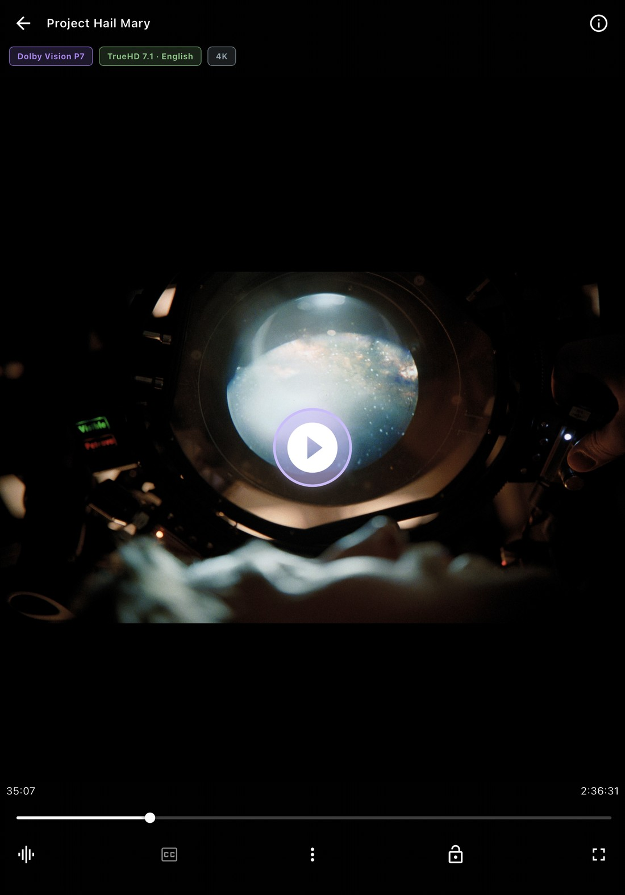

# DreamPlayer

<p align="center">
  
</p>

[](LICENSE)
[](https://github.com/mangeshghodke/DreamPlayer)
[](https://flutter.dev)
[](https://dreamplayer.isroot.in/)
[](https://github.com/mangeshghodke/DreamPlayer/releases)
[](https://apps.apple.com/us/app/dreamplayer-video-player/id6813066889)
[](https://rzp.io/rzp/cZ5afqVG)
[](https://github.com/sponsors/mangeshghodke/)
[](https://discord.gg/sAnXAAA8R)

A cross-platform video player for **Android, iOS/iPad, and Android TV** — built for true Dolby Vision, HDR10/HDR10+, and lossless audio playback.

🌐 **[dreamplayer website →](https://dreamplayer.isroot.in/)** — features, codec support, screenshots and downloads in one place.

💬 **[Join the Discord →](https://discord.gg/sAnXAAA8R)** — chat, help, feature requests and beta invites.

<p align="center">
  <a href="docs/screenshots/ipad/player-dolby-vision.jpg">
    
  </a><br>
  <sub>Player on iPad — <b>Dolby Vision P7 · TrueHD 7.1 · 4K</b> · <a href="docs/screenshots.md">more screenshots →</a></sub>
</p>

## 📲 Now on the App Store

**DreamPlayer is live on the App Store** for iPhone and iPad (requires iOS / iPadOS 18.0+). No ads, no account; a **7-day opt-in free trial**, then an optional Premium subscription unlocks Dolby Vision / HDR playback, subtitle styling, playback speed, A-B repeat, sleep timer, downloads and OpenSubtitles — browsing, playback, subtitle viewing, chapters, PiP, background audio, resume and 5.1/7.1 stereo downmix stay free. **Android builds are completely free** — every feature, no paywall.

[](https://apps.apple.com/us/app/dreamplayer-video-player/id6813066889)

## ✨ Highlights

- **True Dolby Vision (P7/P8/P9) + HDR10/HDR10+/HLG** passthrough to the panel, and **lossless audio** — DTS, DTS-HD, TrueHD, E-AC3, AC3, FLAC — plus a one-tap **5.1/7.1 → stereo downmix** (Settings → Audio) that keeps dialogue loud on headphones/speakers
- **In-app network playback** — SMB/NAS, WebDAV, FTP/SFTP, Jellyfin, DLNA/UPnP on both platforms, with encrypted credentials
- **Smart library** — TMDB metadata, continue watching, offline search, grouping, watched marks, downloads to device
- **Subtitles** — embedded + sideloaded sidecars auto-attach, full styling, OpenSubtitles search
- **Two Android engines** — Media3 (DV/HDR) or MPV (user-chosen), plus PiP, chapters, skip-intro, gestures, AirPlay on iOS
- Localization (EN/ES/ZH/RU/FR), Android TV 10-foot UI, alternate app icons

👉 **[Full feature list →](docs/features.md)** · **[Playback engines →](docs/engines.md)** · **[Spatial audio →](docs/spatial-audio.md)** · **[Screenshots →](docs/screenshots.md)**

## Requirements

| Platform | Minimum version |
|---|---|
| Android | 5.0 (API 21) |
| iOS / iPadOS | 18.0 |

## Download

- **iOS / iPadOS** — [App Store](https://apps.apple.com/us/app/dreamplayer-video-player/id6813066889)
- **Android** — prebuilt APKs on the [Releases](https://github.com/mangeshghodke/DreamPlayer/releases) page (universal + arm64/armv7/x86_64), or one-tap updates with Obtainium:

<a href="https://apps.obtainium.imranr.dev/redirect?r=obtainium%3A%2F%2Fapp%2F%257B%2522id%2522%253A%2522com.dreamplayer.app%2522%252C%2522url%2522%253A%2522https%253A%2F%252Fgithub.com%252Fmangeshghodke%252FDreamPlayer%2522%252C%2522author%2522%253A%2522mangeshghodke%2522%252C%2522name%2522%253A%2522DreamPlayer%2522%257D"></a>

👉 **[Installation details (APK flavours, signing, TestFlight) →](docs/installation.md)**

## Getting Started

```bash
flutter pub get
flutter run                    # run on a connected device
flutter test                   # run tests
flutter analyze                # static analysis
```

For TMDB metadata, copy `.env.example` to `.env` and add your API key:

```bash
flutter run --dart-define-from-file=.env
```

## Support & crash reports

- 💬 **[Discord](https://discord.gg/sAnXAAA8R)** — chat, help, feature requests, beta invites
- 🐛 [GitHub Issues](https://github.com/mangeshghodke/DreamPlayer/issues) — bug reports
- 📧 dreamplayersupport@gmail.com

**If the app froze or crashed**, open **Settings → "App crashed?"** and tap it — an in-app form lists the debug logs that exist on your device (on Android the tap first dumps logcat, which is the only log that captures native crashes) with checkboxes, a message box, and **Submit** to upload or share them.

## License

Copyright (C) 2026 Mangesh Ghodke. Released under the [GNU General Public License v3.0](LICENSE).

## Support

If DreamPlayer is useful to you, consider supporting the project:

- [Razorpay](https://rzp.io/rzp/cZ5afqVG) — UPI, cards, or netbanking (India)
- [GitHub Sponsors](https://github.com/sponsors/mangeshghodke/) — recurring support

Both are also in the app under **Settings → Support**.
