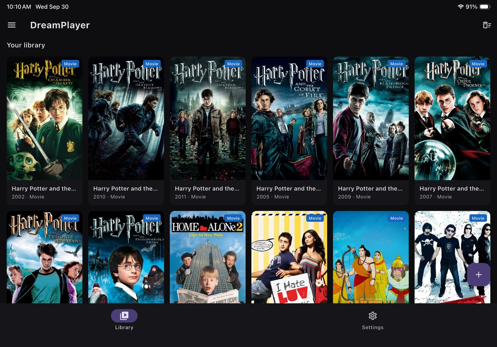
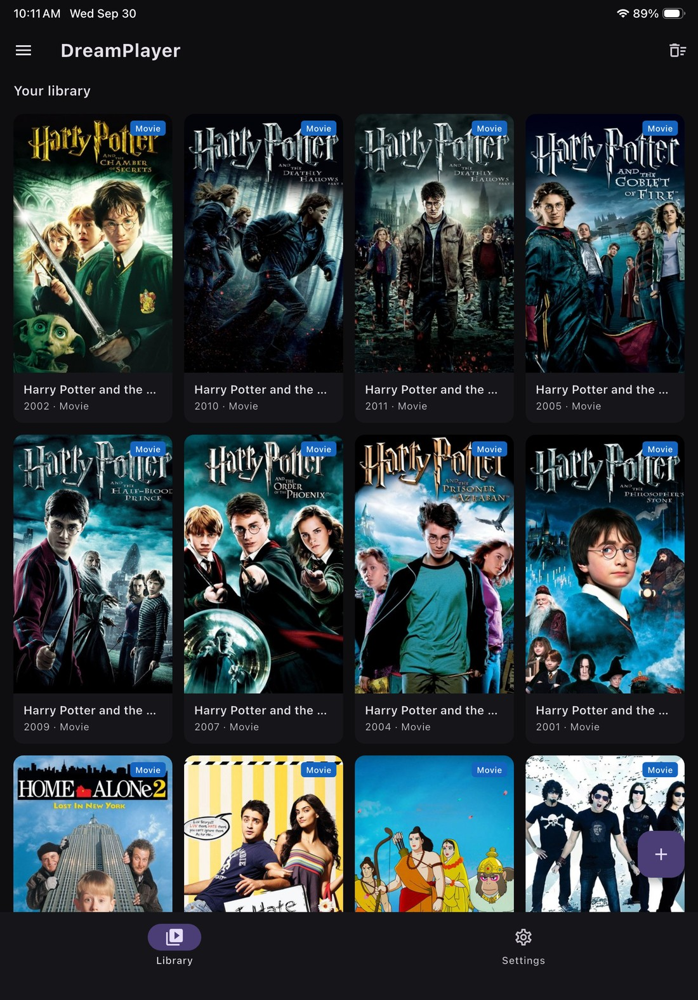
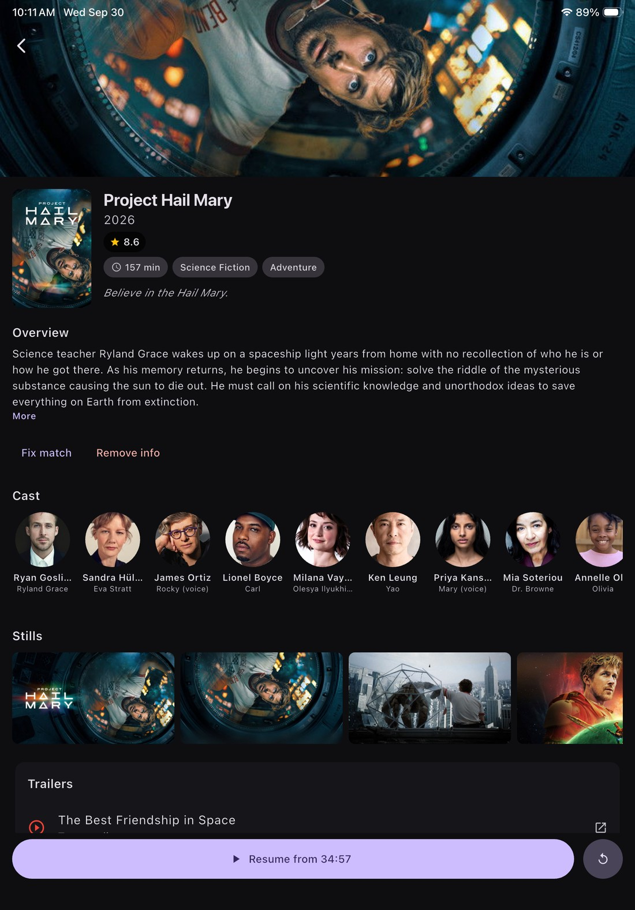
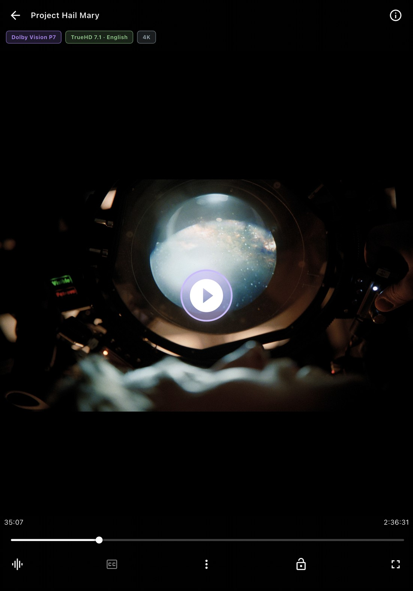
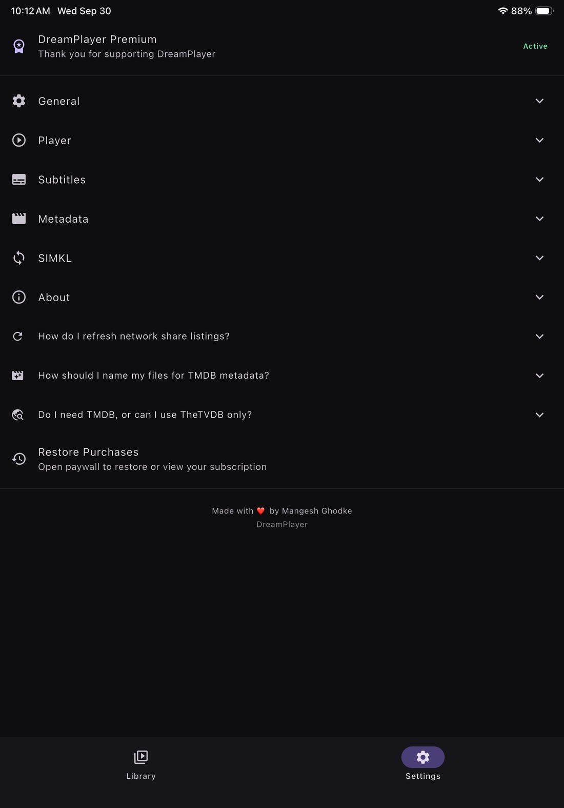
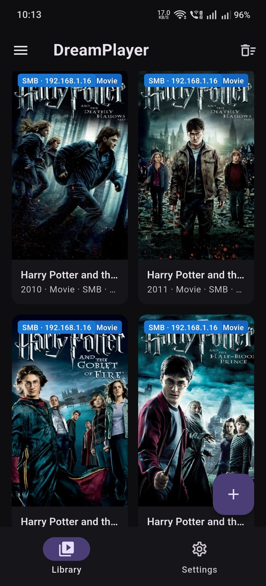
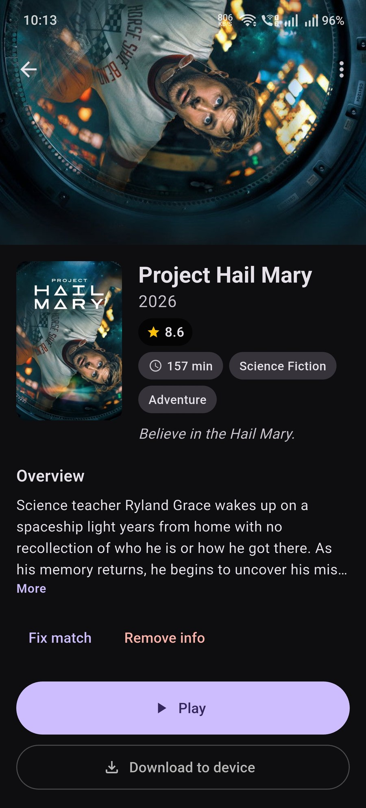
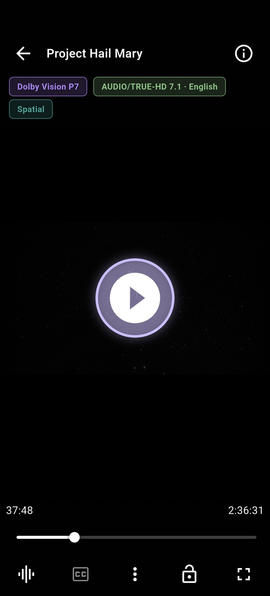
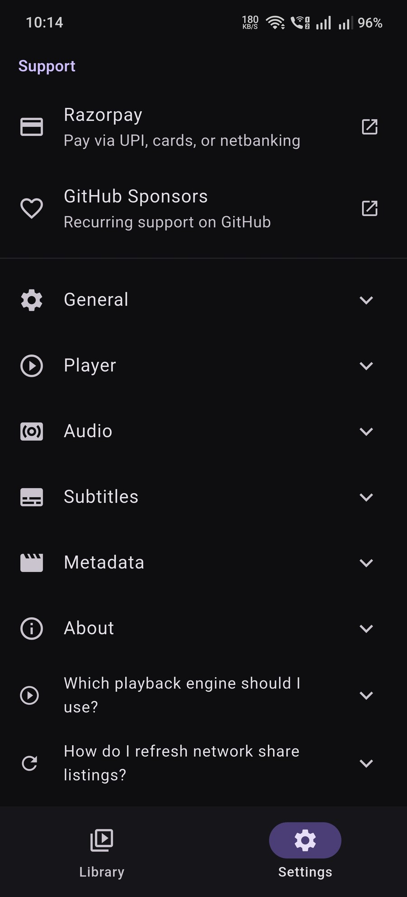

# DreamPlayer

<p align="center">
  
</p>

[](LICENSE)
[](https://github.com/mangeshghodke/DreamPlayer)
[](https://flutter.dev)
[](https://mangeshghodke.github.io/DreamPlayer/)
[](https://github.com/mangeshghodke/DreamPlayer/releases)
[](https://apps.apple.com/us/app/dreamplayer-video-player/id6813066889)
[](https://rzp.io/rzp/cZ5afqVG)
[](https://github.com/sponsors/mangeshghodke/)

A cross-platform video player for **Android, iOS/iPad, and Android TV** — built for true Dolby Vision, HDR10/HDR10+, and lossless audio playback.

🌐 **[dreamplayer website →](https://mangeshghodke.github.io/DreamPlayer/)** — features, codec support, screenshots and downloads in one place.

> [!NOTE]
> The website path is **case-sensitive**: `github.io/DreamPlayer/` works, `github.io/dreamplayer/` returns 404. Please copy the link rather than retyping it — and if you add it anywhere else in this repo, keep that exact capitalisation. `test/website_links_test.dart` enforces it.

## 📲 Now on the App Store

**DreamPlayer is live on the App Store** — approved and available on iPhone and iPad.

[](https://apps.apple.com/us/app/dreamplayer-video-player/id6813066889)

**[Download DreamPlayer on the App Store →](https://apps.apple.com/us/app/dreamplayer-video-player/id6813066889)**

- No ads, no account required
- **7-day free trial**, then an optional Premium subscription (monthly, yearly, or a one-time lifetime purchase) — the trial is opt-in from the welcome screen, never automatic
- Premium unlocks **Dolby Vision / HDR playback, subtitle styling, playback speed, A-B repeat, the sleep timer, downloads to device and OpenSubtitles search**. Browsing every source, playback itself, subtitle *viewing*, chapters, picture-in-picture, background audio and resume stay free
- Requires **iOS / iPadOS 17.0** or later
- Play your own files: local storage, Files-app folders, **in-app SMB/NAS on iPhone and iPad**, WebDAV, FTP/SFTP, Jellyfin, DLNA, and "Open with" hand-offs from other apps
- Full Dolby Vision (P7/P8/P9) / HDR10 / HDR10+ / HLG support on capable iPad and iPhone panels, plus lossless audio (DTS-HD, TrueHD, E-AC3, FLAC) — DV Profile 4 is Android-only
- Android builds remain **completely free** — every feature, no paywall — and are on the [Releases](https://github.com/mangeshghodke/DreamPlayer/releases) page

## 📸 Screenshots

Each thumbnail is linked — click any image to open it full size.

### iPad

<div align="center">
<table>
  <tr>
    <td align="center" valign="bottom">
      <a href="docs/screenshots/ipad/library-landscape.jpg">
        
      </a>
    </td>
  </tr>
  <tr>
    <td align="center"><sub>Library in landscape — poster grid, per-title artwork, year · type · source badges</sub></td>
  </tr>
</table>
</div>

<div align="center">
<table>
  <tr>
    <td align="center" valign="bottom"><a href="docs/screenshots/ipad/library-portrait.jpg"></a></td>
    <td align="center" valign="bottom"><a href="docs/screenshots/ipad/details.jpg"></a></td>
    <td align="center" valign="bottom"><a href="docs/screenshots/ipad/player-dolby-vision.jpg"></a></td>
    <td align="center" valign="bottom"><a href="docs/screenshots/ipad/settings.jpg"></a></td>
  </tr>
  <tr>
    <td align="center" valign="top"><sub>Library</sub></td>
    <td align="center" valign="top"><sub>Details — backdrop, cast, stills, trailers</sub></td>
    <td align="center" valign="top"><sub>Player — <b>Dolby Vision P7 · TrueHD 7.1 · 4K</b></sub></td>
    <td align="center" valign="top"><sub>Settings</sub></td>
  </tr>
</table>
</div>

### Android

<div align="center">
<table>
  <tr>
    <td align="center" valign="bottom"><a href="docs/screenshots/android/library-smb.jpg"></a></td>
    <td align="center" valign="bottom"><a href="docs/screenshots/android/details.jpg"></a></td>
    <td align="center" valign="bottom"><a href="docs/screenshots/android/player-spatial.jpg"></a></td>
    <td align="center" valign="bottom"><a href="docs/screenshots/android/settings.jpg"></a></td>
  </tr>
  <tr>
    <td align="center" valign="top"><sub>Library — per-source <b>SMB / NAS</b> badges</sub></td>
    <td align="center" valign="top"><sub>Details — <b>Download to device</b></sub></td>
    <td align="center" valign="top"><sub>Player — <b>Dolby Vision P7 · TrueHD 7.1 · Spatial</b></sub></td>
    <td align="center" valign="top"><sub>Settings</sub></td>
  </tr>
</table>
</div>

## Highlights

### Dolby Vision & HDR
- Plays **Dolby Vision** Profiles **P7 / P8 / P9** at 4K 60fps with zero dropped frames — chip shows `DV P8`, `DV P7`, etc.
- **Profile 4** (single-layer IPTPQc2, a broadcast/IPTV profile) plays on **Android** only. iOS has no P4 decoder and no backward-compatible base layer to fall back to, so it reports a clear "not supported" message instead of failing silently.
- Full **HDR10 / HDR10+ / HLG** passthrough to the display panel
- **Hardware SDR tone-mapping (Android, opt-in)** — Settings → Player → *Hardware SDR tone-mapping* asks the decoder to output standard SDR instead of the source's HDR/Dolby-Vision signal, so the phone's own hardware tone-mapper converts on the chip. The system colour modes (Vivid/Natural, white balance) apply to the picture again, and **Dolby Vision Profile 5 stops rendering green/purple**. It costs no CPU and 4K60 stays smooth. The trade-off is deliberate — the picture leaves the HDR path, so the panel no longer receives real Dolby Vision or HDR10 — which is why it is off by default. When the codec confirms the conversion, the chip reads **"Tone-mapped SDR"** instead of claiming Dolby Vision
- Live on-screen chips showing the active HDR format (profile-aware), video codec, audio codec, and resolution
- Graceful fallback on non-DV devices (P7/P8 as HDR10, P4/P5 show a clean error)

### Lossless Audio
- All major codecs: **DTS, DTS-HD, TrueHD, E-AC3, AC3, AAC, FLAC** and more
- Mid-playback **audio track switching** with full track names and channel info
- **Default track on open** — the player picks the file's DEFAULT-flagged audio
  track (not merely the first entry in the list); **resume keeps your last pick**
  per video, per engine (Watch from beginning returns to the default)
- Optional **Media3 audio passthrough** over HDMI for Dolby Atmos / DTS:X on compatible soundbars
- **Spatial audio** (Android 13+) — the same phone Spatial-audio setting drives both Media3 and MPV; the teal chip shows when the system Spatializer can virtualize the current multichannel PCM output on wired, USB, and Bluetooth routes
- **Bass Boost** — Off/Low/Medium/High session-level DSP that restores the low-end HRTF virtualization thins out (appears while Spatial audio is engaged)
- **Volume Boost + Night Mode** — swipe the volume past 100% for up to 2× (200%) of make-up gain, applied to the decoded audio itself with a peak limiter, so it lifts the whole mix instead of crushing the centre channel (Android). Night Mode adds a further +4 dB. A warning appears the moment you cross 100%

### Subtitles
- **Embedded + sideloaded** — every subtitle file next to the video auto-attaches
- **Network-share sidecars** — `.srt`/`.ass`/`.vtt`/`.sub`/`.ttml`/`.smi`/`.mpl2` files
  in the same SMB / WebDAV / FTP folder as the video are auto-discovered and
  attached as external tracks. The best filename match is auto-selected
  (`Show.S01E01.eng.srt` matches `Show.S01E01.mkv`). Works on Android for
  every network source — local files, SMB shares, WebDAV servers, FTP/SFTP
  servers, Jellyfin libraries, and "Open with" hand-offs. iOS supports the
  same behaviour for local files (via `AetherPlayerView`); server-side
  external sub discovery for WebDAV/FTP on iOS is on the roadmap.
- **Priority: sidecar > server external > embedded.** The first sidecar
  match is flagged as the default track; the rest are reachable from the
  CC button. When a folder has zero matches, the player falls back to the
  container's embedded track automatically.
- **Fallback-engine subs** — the libmpv fallback engine has the same priority
  rule. External subs are added with `sub-add` (non-defaults) and
  `setSubtitleTrack` (default), so mpv's track-list mirrors the Media3 path
  and the CC sheet shows every track by real filename.
- Supports SRT, SSA/ASS, WebVTT, TTML, SAMI, MicroDVD, MPL2, SubViewer
- **VobSub (`.idx` + `.sub`) bitmap subtitles play on the libmpv engine.** These
  are a two-file pair and are *not* offered on the native Media3 engine: ExoPlayer's
  `VobsubParser` only accepts Matroska `S_VOBSUB` framing, so a sidecar pair has
  nowhere to be fed from. Use **Play with MPV** for these — it renders them
  correctly. No other engine-level player supports them either (nextplayer
  whitelists `srt/ssa/ass/vtt/ttml`, Nova uses its own FFmpeg core, Just Player
  silently shows a blank track).
- Full track picker with Off option; subtitles are anchored to the video, not the screen
- **Appearance settings** — size, color, background, outline, and sync delay with live preview (in the player's ⋮ menu; delay live on Android via `DelayingParser` + reopen)
- **OpenSubtitles** — search/download from CC (5/day anon, 20/day free login); Nova-based language catalog (full names, 3-letter `eng/fre/pob/zho`, `zh-CN/zh-TW`) for reading + download prefs + text encoding (CP1250…CP949)

### Network Playback
- **SMB / NAS** — in-app SMB browser on **both** iOS and Android: add a server, browse its shares, pin a folder to Home, and play. A subnet sweep finds servers on the LAN and reports each one's SMB version; saved servers show a green/red reachability dot. Playback reads go straight to the share over **libsmb2**, with parallel read-ahead, on both engines — resume plus the saved audio track both survive reopening. CX Explorer "Open with" handoff also works
- **WebDAV** — browse and stream from WebDAV servers on both platforms
- **Jellyfin / Emby** — browse libraries, direct-play with auto-discovery
- **FTP / SFTP** — browse and stream from FTP servers and SSH/SFTP file hosts
- **DLNA / UPnP** — discover and play from media servers on your LAN
- **Files app "Open with"** on iPad with bookmarked folders
- Encrypted credentials (Android Keystore / iOS Keychain)

### Smart Library
- **Continue watching** — resume any partially-watched video with progress bars
- **Library search** — the Home app bar has a search button for everything already in the library: shows, season folders, episodes, movies and manual groups. It matches titles, file names, episode codes and original titles as you type, is accent- and case-insensitive, and works **offline** — metadata only enriches entries that are already there, it never adds results that cannot be played. Each row names its source
- **User-added folders** — add a TV show or movie folder, get a TMDB poster and episode list; **deep recursive scan** (up to 5 levels) expands mixed containers so loose files aren't hidden behind parent cards
- **Movie-part folders stay separate** — `Das Finale 01`–`04` each get their own card with the correct per-part TMDB match
- **Manual grouping** — select cards (long-press) → Group → one grouped card with the name you choose; TV series still auto-group by name
- **Bookmark network folders to Home** — pin SMB and WebDAV folders straight from their browsers, with a colored source badge (Jellyfin/FTP/DLNA are browse-only via `+` menu)
- **Season auto-expand** — bookmarking a show expands each season into its own card (`House Season02`, `House Season03`); group manually if you want one card
- **Download to device** — download network videos for offline playback (SMB, WebDAV, HTTP, Jellyfin, UPnP), or copy a file off a USB drive or SD card; progress lives in the notification panel and the list is in the home screen's hamburger menu
- **Downloaded files in home grid** — completed downloads appear with a checkmark badge, tap to play
- **SIMKL watched sync** — free unlimited watch-history sync (`simkl.com`); auto-pushes finished videos and syncs watched state across devices
- **File browser** — browse device storage and play any video without importing. USB drives and SD cards appear as volumes ("USB drive (name)"), and the list re-scans whenever you return to the screen or tap **Rescan drives**
- **Multi-select delete** — long-press files or folders to select, then ⋮ → Delete. Folders are deleted recursively, with the confirmation spelling that out

### Localization
- **English, Spanish, Chinese Simplified, Russian** — 549 translated strings across all 13 screens
- **Auto-detect** device language on launch; optional **Settings → General → Language** override
- Technical terms (codec names, HDR, Dolby Vision, etc.) stay English by design

### Appearance
- **Alternate app icons** — Settings → Appearance → *App icon* switches between five launcher icons (default, logo-only, red, green, cyan). Android switches the launcher component itself; iOS uses the system alternate-icon API

### Movie Metadata (TMDB)
- Every video opens a **details screen** with poster, backdrop, synopsis, rating, genres, runtime, and cast
- Metadata auto-fetches in the background — rows show poster thumbnails before you tap
- TV episodes labeled with Season/Episode info
- "Fix match" to correct a wrong auto-match
- **Grouped screens get the full header** — backdrop hero, overview, rating, genres, cast, trailers, then the poster cards
- **Player top bar** shows the TMDB title (falls back to the file name)
- **Rows fall back to the poster** when an episode has no still of its own, so a missing still never reads as a broken thumbnail

### Player Controls
- Play/pause, seek, ±10s, fullscreen, auto-hiding UI
- **Swipe gestures** — swipe left side for brightness, right side for system volume (phones/tablets, togglable in Settings)
- Aspect ratio picker: Fit, Crop, Stretch, 16:9, 4:3 (persists per video)
- **Chapters** — previous/next chapter buttons beside the transport (press previous twice to walk back, not just restart the current one) and ticks on the seekbar, on both engines and on local, SMB, WebDAV, FTP, UPnP and Jellyfin sources
- **AirPlay (iOS)** — the real system AirPlay picker is embedded in the player top bar; video goes out on the native AVPlayer path, while FFmpeg-backed containers (MKV/TS/AVI) can send audio only
- **Keyboard shortcuts (non-TV)** — `K` / Space play-pause, `J` / `L` seek ∓10 s, `F` fullscreen; left/right seek while the controls are hidden
- **Playback speed** 0.25×–2× with refresh-rate matching on Android
- **Frame interpolation (MPV, Android)** — the picture panel (the sliders button at the top right) → *Frame interpolation* picks a target rate (30 / 48 / 60 / 120 fps) and a quality (Sharp / Balanced / Smooth), so a 24 fps film plays at 60 fps with blended in-between frames and pans stop looking choppy. It is MPV-only by design: Media3 has no interpolation API, and producing the extra frames on the native engine would mean routing the decoder through our own GPU renderer — which would cost the Dolby Vision / HDR passthrough the native engine exists for. Set a default in Settings → Player, or change it live from the picture panel. The target is also **capped automatically when the phone gets warm** (Android thermal headroom), and the same reading steps the Anime4K preset down — the quality never climbs back on its own, so the picture doesn't keep changing under you
- **Thermal-aware quality (Android)** — while the MPV engine plays, DreamPlayer samples the device's thermal headroom every 10 s and eases the GPU-heavy features down before the phone throttles
- **Pinch-to-zoom**, horizontal-swipe seek, double-tap-to-seek ±10 s
- **Touch lock** — locks gestures during playback; tap once to reveal the unlock button
- **Watched marks** — videos auto-mark as watched at the end; toggle manually per row
- **Auto-play next episode** within the same folder — local/SMB + **Jellyfin via ParentId sibling walk** (togglable)
- Resumes playback from where you left off, even after app close or screen lock
- **Picture-in-Picture** — system-drawn transport controls (rewind, play-pause, forward) work for BOTH engines, including the libmpv engine
- **Two play engines — your choice** — every video's details screen shows **Play** (Media3) and **Play with MPV** (libmpv, Android). mpv runs hardware-first (`hwdec=auto-safe`) with its own FFmpeg software fallback and decodes lossless codecs to PCM through Android `AudioTrack`; Media3 retains optional HDMI bitstream passthrough. Video renders into a **native SurfaceView** (not a Flutter texture). Media3 remains the DV/HDR engine; the MPV path can optionally convert the picture (Settings → Player → *HDR tone-map*: SDR tone-map, Native HDR/DV, Linear HDR, HDR10 PQ, HLG, BT.2020 wide gamut) when a libplacebo-enabled libmpv is present.
- **Anime4K for MPV (Android, opt-in)** — enable the Anime4K toggle in the MPV picture panel, then choose Mode A, B, C, A+A, B+B, or C+A. The selected preset takes effect immediately and an `Upscaled` chip is shown while active. It is limited to SDR MPV playback; HDR/DV and PiP are disabled. The bundled Anime4K v4.0.1 fast presets use legacy `vo=gpu` because they do not compile with `vo=gpu-next`/libplacebo, so libplacebo tone mapping is unavailable while enabled. The panel warns about extra GPU load, heat, battery use, and stutter.
- **Optional TheTVDB metadata** — configure a TheTVDB v4 API key in Settings → Metadata. DreamPlayer keeps TMDB as the primary source, can use TheTVDB as a fallback, and lets you choose it explicitly in Fix Match/Group Poster. Provider IDs and artwork are cached independently; SIMKL matching remains TMDB-only.

### Second engine (Android): libmpv

The TMDb details screen offers **Play with MPV** alongside the primary Play
(Media3). The libmpv engine (`media_kit` + bundled libmpv) starts
up front — no Media3 platform view — runs **hardware-first**
(`hwdec=auto-safe` over MediaCodec) and falls back to its bundled FFmpeg
software decode when the hardware can't handle a stream, so anything the
native engine's hardware/software path can't open (12-bit HEVC 4:4:4, a
corrupt container, an unknown codec) plays through FFmpeg. It drives the same
transport, seekbar, gestures, PiP, resume, chapter list, and CC sheet as
Media3, and it decodes audio through the bundled FFmpeg path before playback.
It configures Android `AudioTrack` output and keeps the source channels when
possible, so the same phone Spatial-audio setting used by Media3 can virtualize
5.1/7.1 PCM from DTS/DTS-HD, TrueHD, E-AC3, AC3, FLAC, AAC, and similar
tracks. The player observes MPV's actual output format and updates the Spatial
chip when the system setting or audio route changes. MPV's `audio-spdif` is
intentionally not enabled, so encoded bitstream passthrough is not presented
as platform spatial audio. Sidecar subtitles are added explicitly
(external > embedded priority, same rule as the main path). Audio follows the
same rules as Media3: the container's default track on open, your last pick on
resume.

**Video output is a real SurfaceView** (`MpvSurfaceView`), not media_kit's
Flutter `Texture` — textures stutter and have no HDR path. media_kit is kept
for `Player` control only; `media_kit_video` is not a dependency. A
libplacebo/`gpu-next`-enabled `libmpv.so` can be dropped under
`android/app/src/main/jniLibs/` (Gradle `pickFirsts` overrides media_kit's
stock binary) so the picture can be **converted** for files you do not want in
native HDR: Settings → Player → *HDR tone-map* offers SDR tone-map, Native
HDR/DV, Linear HDR, HDR10 (PQ), HLG and BT.2020 wide gamut, and the player
always writes the complete property set so a mode switch can never leave stale
primaries or transfer behind.

**Anime4K (Android MPV only)** is exposed in the same in-player tune panel as
Picture. Enable **Anime4K** first; the default Mode A chain is applied, then
select Mode A, B, C, A+A, B+B, or C+A to replace the chain immediately. An
`Upscaled` chip appears while the chain is active. The bundled fast presets are
pinned to Anime4K v4.0.1; `Clamp_Highlights` and the heavier HQ variants are
not included. Only SDR MPV video is eligible, and the feature is unavailable
for HDR/Dolby Vision and PiP. The current Anime4K shaders do not compile
against the `vo=gpu-next`/libplacebo hook interface, so Anime4K temporarily
uses legacy `vo=gpu` with OpenGL. That means libplacebo tone mapping is not
available while the feature is enabled, and zero-copy hardware decode may
switch to `mediacodec-copy`. The setting is session-only; the panel warns that
per-frame GPU work increases heat, battery use, and stutter risk.

On a terminal Media3 error, the error surface offers **Try with MPV** instead
of a dead end. Media3 never auto-switches — the engine choice is always the
user's (up front, or on the error surface).

It is **not** the DV/HDR primary engine by design: Media3 still owns hardware
Dolby Vision / HDR10+ passthrough to the panel. On a stock (no-libplacebo)
libmpv build the MPV path stays SDR (tone-map setting no-ops safely); with the
custom libmpv the HDR tone-map mode can convert to SDR intentionally. iOS does
not run mpv; AetherEngine covers its own failures.

For SMB sources the mpv engine gets the file over a tiny loopback HTTP/1.1
server (`SmbHttpProxy.kt`, bound to `127.0.0.1`, byte-range aware). libmpv
can't read `smb://` directly, and the server streams the bytes out of the
**same libsmb2-backed reader with the parallel read-ahead ring the native
engine uses**, so the share is read ahead of the playback while the socket is
fed from memory — the engine never sees an SMB round-trip as a gap in the
stream.

### Optional metadata providers

TMDB remains the default metadata source. Settings → Metadata also accepts an
optional TheTVDB v4 API key and subscriber PIN. When enabled, TheTVDB is tried
only after TMDB fails to produce a confident automatic match; Fix Match and
Group Poster also let you choose TMDB or TheTVDB explicitly. TheTVDB results
reuse the existing title, artwork, cast, season, and episode models, while
provider-qualified IDs prevent collisions in the cache. The API key and optional
PIN are stored in Android Keystore-backed storage or the iOS Keychain; legacy
values are migrated at startup, and Android excludes the legacy Dart preferences
file from backup. SIMKL synchronization continues to use TMDB IDs only.

Provider artwork and episode data remain subject to each provider's terms and
attribution requirements. See [TheTVDB](https://thetvdb.com/) for details. This
product uses the TheTVDB API but is not endorsed by TheTVDB.

AVDb is also available as a third provider, behind **Settings → Metadata → AVDb**.
It is free, needs no API key, and covers adult titles that neither TMDB nor
TheTVDB carry well. It is deliberately limited to movies: it has no season data
and no ratings, so an episode never resolves through it and rows show no star
rather than an invented score. Selecting a provider there shows only that
provider's credential field, with TheTVDB offered as an optional fallback.

**r18.dev** is the other key-free provider, behind **Settings → Metadata →
r18.dev**. It is a different catalogue from AVDb: it is keyed by the code in the
file name (`SVFLA-012` and `SVFLA012` are the same record) rather than by free
text, so a file whose name carries the code resolves to a rich record with the
poster, the cast, the release date, the studio, the genres and the sample-video
frames. Both are searched when either is enabled, and the one that matches
supplies the artwork and synopsis — the details are never fetched from a
different provider than the one that matched.

Third parties can add a provider through the `MetadataProviderAdapter` seam
(`lib/services/metadata_provider_adapter.dart`) instead of being taught to
`TmdMovie` and the cache one at a time.

**Adult content** is off by default. Settings → Metadata → *Include adult
content* is the only switch: TMDB is asked `include_adult=false` everywhere
until you turn it on, so adult titles resolve to no match at all while it is off.
It affects TMDB metadata matching only and changes nothing about what the app
will play.

### Android TV / Fire TV
- Full 10-foot UI with D-pad navigation and custom focus highlights
- Leanback launcher banner
- Dolby Vision + HDR10 passthrough to the TV panel
- Audio passthrough for Atmos/DTS:X over HDMI
- **Settings → Player is available on the stick** — engine picker, video decoder, auto-play next, Picture-in-picture and the on-screen badges are all reachable with the remote. Only the touch-only *Swipe gestures* row is hidden on TV
- Tested on Amazon Fire TV Stick 4K (Fire OS 7.1)

## Engines Used

DreamPlayer is a video player app, but the actual video *engine* depends on
your platform. Different platforms need different engines to do what we
promise: **Dolby Vision + HDR10 passthrough to the panel, lossless audio
decoding, and a stable 4K 60 fps picture on a phone.**

| Engine | Platform | What it does | Why we picked it |
|---|---|---|---|
| **Media3 / ExoPlayer 1.10.x** | Android phone, tablet, Android TV, Fire TV | The Google-maintained Android playback engine. We use it through a **hybrid-composition `PlatformViewLink`** so the `SurfaceView` is a real SurfaceFlinger layer on the physical display. This is the only path that delivers real HDR/DV to the panel. Built on top of Media3 is our `DreamRenderersFactory` which adds the **nextlib FFmpeg audio extension** for DTS / DTS-HD / E-AC3-JOC / TrueHD / FLAC. | The only engine that does hardware Dolby Vision on Android (`c2.qti.dv.decoder` on the OnePlus, `OMX.MTK.VIDEO.DECODER.DVHE.STH` on the Fire TV) with real HDR composited on the panel. Nova Video Player, Just Player, Plex, MX Player Pro all use it. |
| **AetherEngine 6.38.x** | iOS / iPad | Native iOS playback built on AVPlayer + FFmpeg demux/decode. The AetherPlayerView exposes a `videoFormat` for `.hdr10 / .hdr10Plus / .dolbyVision`, the engine reads the container, FFmpeg fills in what AVPlayer can't (DTS / DTS-HD / TrueHD, MKV / WebM / TS / AVI containers), and the engine routes bitstream-audio over HDMI. | The only path that combines AVPlayer's hardware HDR / DV fast path on the panel with FFmpeg's container / codec coverage for non-Apple formats. iOS has no ExoPlayer port. |
| **nextlib `media3ext`** | Android (FFmpeg audio) | The Android FFmpeg extension that adds `FfmpegAudioRenderer` for DTS / DTS-HD / TrueHD / FLAC. Wired into `DreamRenderersFactory` AFTER the stock audio renderer, so it acts as a fallback for the lossless codecs. | The same FFmpeg integration Nova Video Player uses. Video stays on hardware `MediaCodecVideoRenderer`; audio falls back to FFmpeg for the formats the OS can't decode. |
| **Citadel (SwiftNIO SSH)** | iOS / iPad SFTP | Native SFTP client used by the FTP browser for SFTP playback (`FtpByteRangeSource`). | The only maintained Swift SSH client that compiles cleanly on iOS 17. |
| **libsmb2** | **Android + iOS / iPad SMB reads** | The C SMB 2/3 library behind **all** SMB playback. On iOS it also does browsing, share listing, LAN discovery and stat: discovery is a subnet sweep plus a real IPC$ handshake to report dialect and server GUID, and playback serves the engine through a synchronous `smb2_pread` reader — no async-to-sync bridging, so the deadlock class the old iOS transport hit cannot recur. On **Android** the *read* path uses it too (a JNI bridge over the same vendored sources), for both the native engine and the MPV fallback. Vendored under `ios/Runner/libsmb2`, compiled for iOS by `ios/libsmb2_build.sh` and for Android by `android/app/src/main/cpp/CMakeLists.txt`. LGPL 2.1. |
| **jcifs-ng** | Android SMB **browsing** | The Java SMB 2/3 client behind the in-app SMB browser (directory listing) and the small sidecar-subtitle fetch on Android. The bulk byte reads no longer go through it. | Nova's and CX Explorer's SMB library; measured ~75 MB/s vs ~4–6 MB/s for smbj on the NAS. Kept for browsing because it is pure Java and needs no native build step. |
| **Media3 / DefaultHttpDataSource + OkHttp** | Android HTTP(S) | Standard Media3 HTTP source (with a custom trust-all OkHttp client for self-signed WebDAV). | Reuses Media3's mature HTTP implementation; the self-signed client is opt-in per server. |
| **WebDAVByteRangeSource** (in `AetherEngineSMB`) | iOS / iPad WebDAV | A `ByteRangeSource` that serves every engine read as an independent HTTP `Range` request with the `Authorization` header, on a permissive or default-trust session. Wrapped in `BufferedSMBReader` for read-ahead. | AetherEngine's own HTTP stack can't carry auth headers or bypass TLS validation; this is the cleanest bridge between the WebDAV client and the engine. |
| **media_kit + libmpv** (hardware-first `hwdec=auto-safe`, FFmpeg software fallback; video → **native SurfaceView**) | Android, user-chosen | **Second engine**: `Play with MPV` on the details screen (or `Try with MPV` on the Media3 error surface) starts a bundled libmpv that runs hardware decoders by default and drops to its own FFmpeg software decode when the hardware can't handle a stream — so files the native engine's hardware/software path can't open (12-bit HEVC 4:4:4, corrupt containers, unknown codecs) play through FFmpeg. Video renders into `MpvSurfaceView` (hybrid-composition platform view — same pattern as Media3; **no Flutter `Texture`**, which stuttered). media_kit `Player` is control-only (`media_kit_video` removed). Configures Android AudioTrack + FFmpeg PCM output; DTS / DTS-HD / TrueHD / E-AC3 / AC3 / FLAC / AAC sources can feed the platform Spatializer when the route stays 5.1/7.1. It observes `audio-out-params` and does not enable `audio-spdif`, so encoded passthrough is not reported as spatial. Pins the container-default audio track on open and restores the user's pick on resume. Ships `libmpv.so` via `media_kit_libs_android_video` — optionally overridden by a libplacebo/`gpu-next` build under `jniLibs/` (Gradle `pickFirsts`) for HDR tone-map. Android-only, so iOS doesn't pull in `Mpv.framework` (which breaks SideStore's `ldid` signer). | The user gets a second full player for anything Media3 can't decode, without giving up hardware decode or multichannel audio. Media3 remains the DV/HDR engine; MPV can tone-map to SDR when asked. iOS does not run mpv. |
| **SmbHttpProxy** (in-app) | Android fallback over SMB | A tiny HTTP/1.1 server (ServerSocket accept loop, one daemon thread per connection, GET/HEAD + single `Range`) bound to `127.0.0.1` that serves an SMB file to the MPV engine. The bytes come out of `SmbDataSource` — the same libsmb2 reader with the parallel read-ahead ring the native engine uses — so the NAS is never on the socket's critical path and the engine sees a continuous stream instead of a gap per SMB round-trip. | libmpv can't read `smb://` directly, and Media3-native `DataSource`s are not reachable from it, so a loopback HTTP bridge is the cleanest way to let the second engine stream a share. Reading *ahead* (instead of read-then-write per round-trip) is what keeps it from reporting "buffering". |

### Why is Media3 the primary engine — and how does mpv fit?

We tried mpv earlier as the **primary** path. It is not the right choice for
the primary DV/HDR path on Android, and we deliberately do not pretend
otherwise. The two blockers for *mpv-as-primary*:

1. **Dolby Vision RPU parsing fails** on the stock mpv/FFmpeg pairing we first
   tested. Result: pink/green output. (mpv PR #16818 was the upstream fix
   attempt; it never landed for our original FFmpeg version.)
2. **Flutter textures have no HDR path** (media-kit issue #615) — so the old
   texture-based mpv path tone-mapped to SDR before the panel ever saw the
   frame. We fixed the *renderer* (mpv now uses a native SurfaceView) but
   Media3 remains the engine that does hardware DV/HDR passthrough.

So mpv is **not** the primary engine. The exit interview was: keep Media3 +
native SurfaceView for the DV/HDR fast path; ship native FFmpeg audio for the
lossless codecs; that's the same engine stack Nova Video Player uses
(ExoPlayer + FFmpeg audio) and the same one Just Player uses (stock
`DefaultRenderersFactory` + nextlib `media3ext`).

**But** mpv *is* a great second engine, and the choice is yours:

- The main Media3 engine + hardware decoders remain the default play path.
- **Play with MPV** (details screen) starts libmpv up front — hardware-first
  (`hwdec=auto-safe`) with its own FFmpeg software fallback — for anything
  you want routed through mpv's decoder coverage. Video goes to a real
  SurfaceView; the ⓘ info sheet shows `Engine · libmpv` while it's active.
- On a terminal Media3 error the error surface offers **Try with MPV** instead
  of auto-switching — the engine choice is always explicit.

Documented in `AGENTS.md → Player engine choice` and `Playback research notes`.

### Why not libVLC / other FFmpeg wrappers?

- **libVLC** — works for SD content, but VLC's Android player renders
  into a `Surface` it doesn't own. To get real HDR passthrough you'd
  need VLC's `mediacodec-hardware` decoder chain, which still doesn't
  handle the DOVI RPU correctly on most devices. The VLC-for-Android
  fork that *does* (libVLC ≥ 4.0 with the `dovi` plugin) is a 100 MB
  binary, ships its own player UI, and is licensed LGPL-2.1 (the
  App Store constraint would force us to relink it).
- **"ffmpeg-kant" / other FFmpeg wrappers** — pure-software decode on a
  phone. 4K HDR HEVC at 60 fps stutters on every Snapdragon 678 / 7
  gen 1 / 8 gen 2 device we've tested. No native hardware path.

## Spatial Audio on Android

DreamPlayer surfaces the **system Spatializer** (Android 13+,
`AudioManager.getSpatializer()`) as a teal **"Spatial"** chip in the
player top bar. When the chip is on, your phone is virtualizing the
surround mix for your output device (stereo headphones, phone speaker,
or a USB DAC). The Spatializer is implemented by the OEM, so the
quality / available modes vary by device. The chip turns on only when
the system reports:

1. The Spatializer is available on this device.
2. The current routing (headphones, USB, etc.) supports spatialization.
3. The current output is decoded multichannel PCM (typically 5.1/7.1); the
   source codec itself is not the deciding factor.

Both Media3 and MPV use the same Android phone setting. MPV decodes DTS/DTS-HD,
TrueHD, E-AC3, AC3, FLAC, AAC, and similar tracks to PCM through
`AudioTrack`; the Spatial chip is shown only when that output remains eligible
for the active route. Stereo/downmixed output and encoded bitstream passthrough
are not platform-spatialized.

To enable spatial audio in DreamPlayer:

1. **Connect headphones or a USB DAC.** Phone speakers don't get
   spatialized on most devices.
2. **Open the file you want to play.** A multichannel track is required
   — a stereo `.aac` won't engage the Spatializer.
3. **Enable system spatial audio:**
   - **OnePlus / OPPO** — Settings → Sound & vibration → Spatial Audio
     → enable, then choose "Music & Video". On ColorOS 13+ this is
     under Settings → Sound & vibration → Dolby Atmos / OPlus Audio.
   - **Samsung (One UI 6+)** — Settings → Sounds and vibration → Sound
     quality and effects → Dolby Atmos for games / movies, **and**
     "Adapt Sound" / "Dolby Atmos for headphones" if you're on the
     built-in speakers. The Spatializer only reports available when
     "Dolby Atmos" is on.
   - **Xiaomi (MIUI 14+)** — Settings → Sound & vibration → Sound
     effects → Immersive Sound / Dolby Atmos. On some MIUI builds the
     option is under "Audio tuner" → "Apply sound effects to media".
   - **Pixel (Android 14+)** — Settings → Sound & vibration → Spatial
     audio. The Pixel implementation is limited; some Pixels only
     spatialize on specific Bluetooth codecs (LDAC / aptX Adaptive).
   - **Nothing OS / Motorola / ASUS ZenUI** — most ship with the
     Spatializer disabled. Install **Dirac Audio** / **Dolby Access** /
     your OEM's audio app and enable spatialization from there; the
     system Spatializer reports available once the OEM app is active.
4. **Look for the "Spatial" chip in the player top bar.** When the
   Spatializer is on for the current track the chip turns teal. Tap
   the **ⓘ** button next to the title — the "Spatial audio" row reads
   "On" with the routing info.

The chip is Android-only today. On iOS, Apple spatializes multichannel
soundtracks on the native AVPlayer path and the system controls it from
Control Center → AirPlay / Head-tracking — DreamPlayer does not surface a
state for it yet.

## Requirements

| Platform | Minimum version |
|---|---|
| Android | 5.0 (API 21) |
| iOS / iPadOS | 17.0 |

## Download

Full feature list, codec tables, screenshots and FAQs: **[mangeshghodke.github.io/DreamPlayer](https://mangeshghodke.github.io/DreamPlayer/)**

### iOS / iPadOS — [App Store](https://apps.apple.com/us/app/dreamplayer-video-player/id6813066889)

DreamPlayer is approved and **live on the App Store** for iPhone and iPad (requires iOS / iPadOS 17.0+).

**[Download on the App Store →](https://apps.apple.com/us/app/dreamplayer-video-player/id6813066889)**

### Android

Prebuilt **Android** binaries are on the [Releases](https://github.com/mangeshghodke/DreamPlayer/releases) page.

- **Android** — universal APK + per-architecture APKs (arm64, armv7, x86_64)

#### Get updates automatically with Obtainium

<a href="https://apps.obtainium.imranr.dev/redirect?r=obtainium%3A%2F%2Fapp%2F%257B%2522id%2522%253A%2522com.dreamplayer.app%2522%252C%2522url%2522%253A%2522https%253A%252F%252Fgithub.com%252Fmangeshghodke%252FDreamPlayer%2522%252C%2522author%2522%253A%2522mangeshghodke%2522%252C%2522name%2522%253A%2522DreamPlayer%2522%257D"></a>

[**Obtainium**](https://obtainium.imranr.dev/) installs and updates apps straight from their GitHub Releases, so you get each DreamPlayer build without watching this page. The link above adds DreamPlayer to Obtainium in one tap; if Obtainium isn't installed yet, it offers to get it first.

- Updates are **signature-checked**: Obtainium only installs a build signed with the same key as the one already on your device.
- **Stay on the same APK flavour.** The arm64/armv7/x86_64 builds carry a higher Android `versionCode` than the universal build, so a phone that installed a per-architecture APK cannot later "update" to the universal one — Android reads that as a downgrade. Pick one and keep it.
- Builds before **0.5.2** were signed with a throwaway CI key and must be uninstalled once. From 0.5.2 on, the key is permanent and every update installs over the previous one.

No `.ipa` is published on GitHub Releases. Apple only allows iOS distribution via the **App Store**, **TestFlight**, or **Ad Hoc** (DPLA 7.6 / 3.2(g)). Signed iOS builds are produced by the separate [`ios.yml`](https://github.com/mangeshghodke/DreamPlayer/actions/workflows/ios.yml) workflow, uploaded to **TestFlight**, and released publicly on the App Store.

## Getting Started

```bash
flutter pub get
flutter run                    # run on a connected device
flutter test                   # run tests
flutter analyze                # static analysis
```

For TMDB metadata, copy `.env.example` to `.env` and add your API key:

```bash
flutter run --dart-define-from-file=.env
```

## License

Copyright (C) 2026 Mangesh Ghodke. Released under the [GNU General Public License v3.0](LICENSE).

## Support

If DreamPlayer is useful to you, consider supporting the project:

- [Razorpay](https://rzp.io/rzp/cZ5afqVG) — UPI, cards, or netbanking (India)
- [GitHub Sponsors](https://github.com/sponsors/mangeshghodke/) — recurring support

Both are also in the app under **Settings → Support**.
