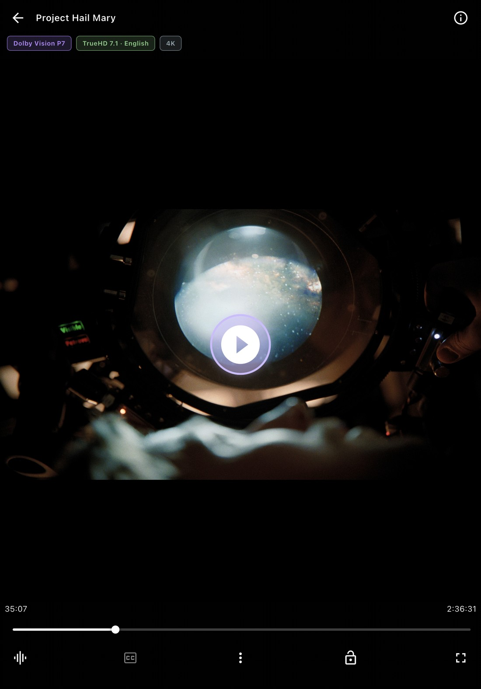
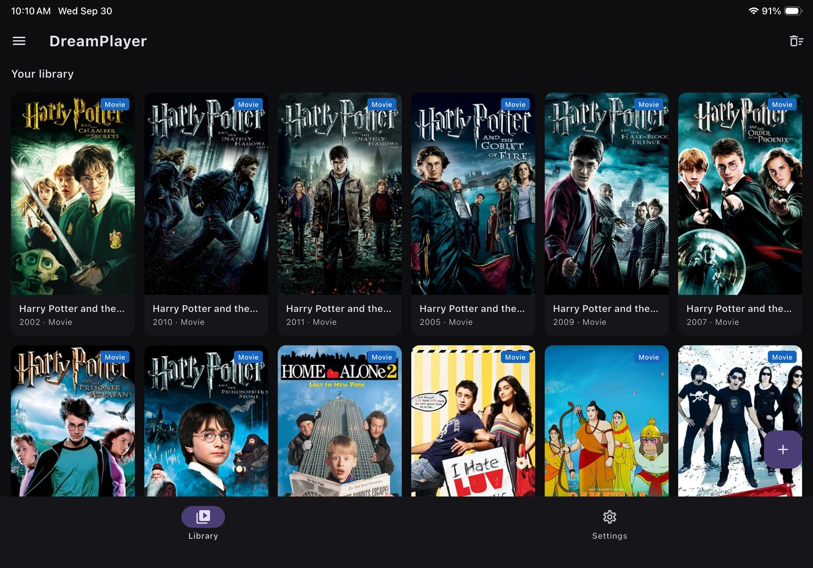
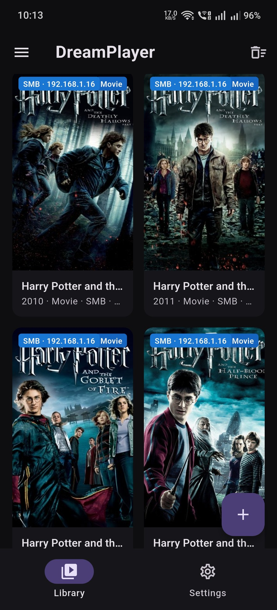
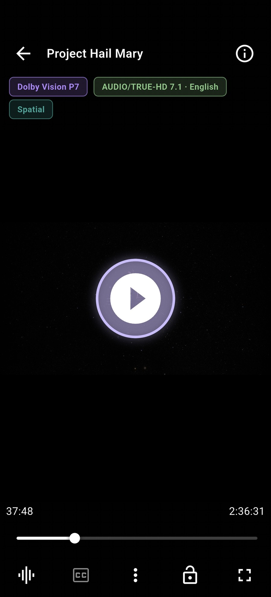
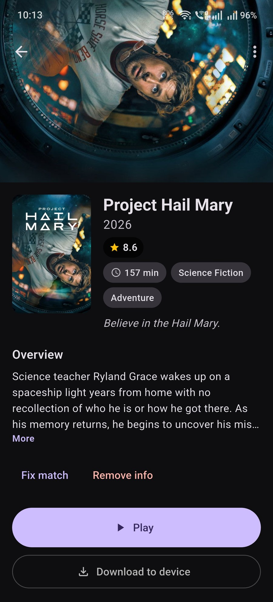
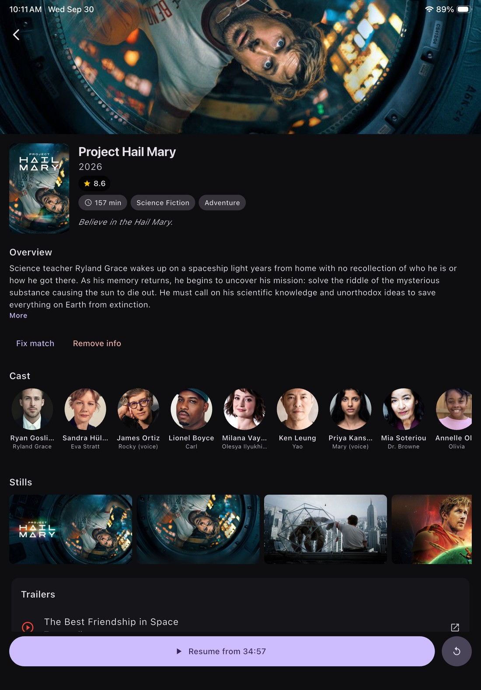

<p align="center">
  
</p>

<h1 align="center">DreamPlayer</h1>

<p align="center">
  <a href="https://apps.apple.com/us/app/dreamplayer-video-player/id6813066889">
    
  </a>
  <br><br>
  <a href="https://apps.obtainium.imranr.dev/redirect?r=obtainium%3A%2F%2Fapp%2F%257B%2522id%2522%253A%2522com.dreamplayer.app%2522%252C%2522url%2522%253A%2522https%253A%252F%252Fgithub.com%252Fmangeshghodke%252FDreamPlayer%2522%252C%2522author%2522%253A%2522mangeshghodke%2522%252C%2522name%2522%253A%2522DreamPlayer%2522%257D"></a>
</p>

<p align="center">
  <b>Real Dolby Vision. Every codec. Your NAS built in.</b><br>
  <i>A cross-platform video player for Android, Android TV, iPhone and iPad — true HDR passthrough, lossless audio, and SMB built into the app.</i><br>
  🌐 <a href="https://dreamplayer.isroot.in/"><b>dreamplayer.isroot.in</b></a> · 💬 <a href="https://discord.gg/sAnXAAA8R"><b>Join the Discord</b></a>
</p>

**DreamPlayer is an open-source (GPLv3) video player for Android, Android TV, iPhone and iPad.** It hands Dolby Vision and HDR10/HDR10+ straight to your display instead of tone-mapping them away in software, decodes lossless audio (DTS, DTS-HD, TrueHD, E-AC3, AC3, FLAC), and browses and plays your NAS directly over SMB, WebDAV, FTP/SFTP, Jellyfin and DLNA/UPnP — no second app needed. No ads, no account.

> [!IMPORTANT]
> **0.5.8 is out.** Grab the Android APKs from [Releases](https://github.com/mangeshghodke/DreamPlayer/releases) — `universal` for a fresh install, or the same ABI file you used last time (arm64-v8a / armeabi-v7a / x86_64). iPhone and iPad: [App Store](https://apps.apple.com/us/app/dreamplayer-video-player/id6813066889) (iOS / iPadOS 18.0+).

<p align="center">
  [](LICENSE)
  [](https://github.com/mangeshghodke/DreamPlayer)
  [](https://flutter.dev)
  [](https://dreamplayer.isroot.in/)
  [](https://github.com/mangeshghodke/DreamPlayer/releases)
  [](https://apps.apple.com/us/app/dreamplayer-video-player/id6813066889)
  [](https://rzp.io/rzp/cZ5afqVG)
  [](https://github.com/sponsors/mangeshghodke/)
  [](https://discord.gg/sAnXAAA8R)
</p>

---

## Showcase

Real captures from real devices — iPad playing a Dolby Vision P7 4K file with TrueHD 7.1, the Android library fed straight from an SMB share, and the player with live format chips:

<div align="center">
  <a href="docs/screenshots/ipad/player-dolby-vision.jpg">
    
  </a>
</div>

<br>

<div align="center">
  
  
  
</div>

<br>

<div align="center">
  
  
</div>

<br>

👉 **[More screenshots →](docs/screenshots.md)** · **[Full feature list →](docs/features.md)** · **[Playback engines →](docs/engines.md)** · **[Spatial audio →](docs/spatial-audio.md)**

---

## What's new in 0.5.8

- 📝 **Pick a subtitle font file from your device** — any `.ttf` / `.otf` from the SD card, Downloads or Files gets copied into the app and applied everywhere (player, MPV overlay, preview)
- 🎨 **Picture controls on the native engine + saved picture profiles** — brightness / contrast / saturation sliders on Media3 too (SDR-only, so HDR passthrough is preserved), with named profiles shared by both engines
- 🔗 **MPV opens remote `https://` links that Media3 already plays** — browser user-agent + auth headers reach mpv now, with an OkHttp loopback bridge as fallback for CDN-refused URLs
- 🖥️ **Hardware SDR tone-mapping now covers plain HDR10 on Qualcomm** — the decoder only honours the SDR request into a TextureView, so the setting now switches the surface (issue #64)

Read the full notes on the [Releases](https://github.com/mangeshghodke/DreamPlayer/releases) page.

---

## Features

DreamPlayer combines a native Media3 engine (Dolby Vision / HDR to the panel) with an optional MPV engine (codec breadth, tone-mapping, shaders), plus network playback, a metadata-rich library and full subtitle tooling.

<details>
<summary><b>🎬 Playback engines & HDR</b></summary>

| Feature | Description |
|---|---|
| **Media3 engine (default)** | Native Android playback with true Dolby Vision (P7/P8/P9) and HDR10/HDR10+/HLG passthrough to the panel via a real hardware surface |
| **MPV engine (optional)** | libmpv for broad codec support, SDR tone-mapping, Anime4K, dual subtitles — choose per video or set a default engine |
| **Hardware SDR tone-mapping** | Optional on-chip HDR→SDR conversion (Settings → Player) so system colour modes apply again; DV Profile 5 no longer renders green/purple |
| **Picture controls + profiles** | Brightness / contrast / saturation live on both engines; save named profiles and re-apply them |
| **Frame interpolation (MPV)** | 30 / 48 / 60 / 120 fps targets with sharp/balanced/smooth quality |
| **Refresh-rate matching** | Android display switches to the video's frame rate for smoother motion |

</details>

<details>
<summary><b>🎵 Audio</b></summary>

| Feature | Description |
|---|---|
| **Lossless codecs** | DTS, DTS-HD, TrueHD, E-AC3, AC3, FLAC and more via the bundled FFmpeg decoders on both platforms |
| **HDMI passthrough** | AC3 / E-AC3 / DTS / DTS-HD / TrueHD bitstream straight to your TV / soundbar (Android TV) |
| **Downmix to stereo** | One-tap 5.1/7.1 → 2.0 fold that keeps the centre channel (dialogue) loud |
| **Boost, night mode, bass** | Volume boost with a peak limiter, dynamic-range night mode, bass boost, audio delay ±5 s |
| **Track memory** | Your audio-track pick is remembered per video, per engine |

</details>

<details>
<summary><b>🌐 Sources & network playback</b></summary>

| Feature | Description |
|---|---|
| **SMB / NAS** | In-app browsing and streaming on both platforms, with encrypted credentials and auto-paired sidecar subtitles |
| **WebDAV, FTP/SFTP, DLNA/UPnP, Jellyfin** | Same folder-browser UI everywhere; Jellyfin also syncs resume position and watched marks to the server |
| **Play URL** | Any http(s) stream plays directly |
| **Download to device** | Save network files locally for offline playback, with progress and cancel |
| **Open with / Files app** | Registered for every video container, so tapping a file anywhere opens DreamPlayer |

</details>

<details>
<summary><b>📚 Library & metadata</b></summary>

| Feature | Description |
|---|---|
| **TMDB + TheTVDB + external providers** | Posters, backdrops, cast, seasons, episode stills — cached for offline use |
| **Smart grouping** | Series folders collapse into one card with seasons; manual groups for anything else |
| **Continue watching & watched** | Resume positions, progress bars, green watched ticks, offline library search |
| **Artwork everywhere** | Your poster/backdrop picks apply on every card; embedded cover art for files without a match |

</details>

<details>
<summary><b>📝 Subtitles</b></summary>

| Feature | Description |
|---|---|
| **Embedded + sidecar auto-pairing** | SRT, ASS/SSA, WebVTT, TTML, SAMI, MicroDVD, MPL2, SubViewer, PGS/DVB — best match auto-selects |
| **Full styling** | Font (built-ins, Google Fonts, or a font file from your device), size, colours, background, outline, position, delay |
| **OpenSubtitles search** | Search and download subtitles in-app, applied mid-playback |
| **Dual subtitles (MPV)** | Render a second track at the top of the screen |

</details>

<details>
<summary><b>▶️ Player</b></summary>

| Feature | Description |
|---|---|
| **Gestures** | Brightness (left) / volume with boost (right) swipes, horizontal-swipe seek, double-tap ±10 s, hold for 2× |
| **Chapters + skip intro/recap/credits** | Chapter ticks on the seekbar, prev/next chapter buttons, and segment skipping from embedded chapters, TheIntroDB and AniSkip |
| **Speed, A-B loop, sleep timer, repeat/shuffle, auto-next** | All in the player menu |
| **PiP, AirPlay, background playback** | Picture-in-picture on both platforms, AirPlay button on iOS, lock-screen / notification controls with artwork |
| **Resume everywhere** | Playhead saved continuously and restored on reopen, across lock/unlock and engine switches |

</details>

<details>
<summary><b>📱 Platforms & UI</b></summary>

| Feature | Description |
|---|---|
| **Android, Android TV, iPhone, iPad** | One APK for phones and TVs (leanback launcher, D-pad UI); App Store build for iOS/iPadOS |
| **Alternate app icons** | Five launcher icons, switchable in Settings |
| **Localization** | English, Spanish, Chinese (Simplified), Russian, French |
| **Responsive & smooth** | Phone, tablet, split-screen and fold layouts; 120 Hz where the panel supports it; large-text safe |

</details>

---

## Requirements

| Platform | Minimum version |
|---|---|
| Android | 5.0 (API 21) |
| iOS / iPadOS | 18.0 |

## Download

- **iPhone / iPadOS** — [App Store](https://apps.apple.com/us/app/dreamplayer-video-player/id6813066889). No ads, no account; a **7-day opt-in free trial**, then an optional Premium subscription unlocks Dolby Vision / HDR playback, subtitle styling, playback speed, A-B repeat, sleep timer, downloads and OpenSubtitles — browsing, playback, subtitle viewing, chapters, PiP, background audio, resume and 5.1/7.1 stereo downmix stay free. **Android builds are completely free** — every feature, no paywall.
- **Android** — prebuilt APKs on the [Releases](https://github.com/mangeshghodke/DreamPlayer/releases) page: `universal` for fresh installs, plus `arm64-v8a`, `armeabi-v7a` and `x86_64`. One-tap updates with [Obtainium](https://apps.obtainium.imranr.dev/redirect?r=obtainium%3A%2F%2Fapp%2F%257B%2522id%2522%253A%2522com.dreamplayer.app%2522%252C%2522url%2522%253A%2522https%253A%252F%252Fgithub.com%252Fmangeshghodke%252FDreamPlayer%2522%252C%2522author%2522%253A%2522mangeshghodke%2522%252C%2522name%2522%253A%2522DreamPlayer%2522%257D (signature-checked).

👉 **[Installation details (APK flavours, signing, TestFlight) →](docs/installation.md)**

## Getting Started

```bash
flutter pub get
flutter run                    # run on a connected device
flutter test                   # run tests
flutter analyze                # static analysis
```

For TMDB metadata, copy `.env.example` to `.env` and add your API key:

```bash
flutter run --dart-define-from-file=.env
```

## Support & community

- 💬 **[Discord](https://discord.gg/sAnXAAA8R)** — chat, help, feature requests, beta invites
- 🐛 [GitHub Issues](https://github.com/mangeshghodke/DreamPlayer/issues) — bug reports
- 📧 dreamplayersupport@gmail.com

**If the app froze or crashed**, open **Settings → "App crashed?"** and tap it — an in-app form lists the debug logs that exist on your device (on Android the tap first dumps logcat, which is the only log that captures native crashes) with checkboxes, a message box, and **Submit** to upload or share them.

---

## Sponsor & support

If DreamPlayer is useful to you, consider supporting the project — scan the QR with any UPI app (BHIM), or open the [payment link](https://rzp.io/rzp/cZ5afqVG) for UPI, cards, or netbanking:

<p align="center">
  <a href="https://rzp.io/rzp/cZ5afqVG">
    
  </a><br>
  <sub>Scan &amp; pay with any UPI app · click the QR for the Razorpay payment page</sub>
</p>

- [GitHub Sponsors](https://github.com/sponsors/mangeshghodke/) — recurring support

Both are also in the app under **Settings → Support**.

---

## Acknowledgments

DreamPlayer builds on excellent open-source projects:

- [AndroidX Media3 / ExoPlayer](https://developer.android.com/jetpack/androidx/releases/media3) — native playback engine (**Apache-2.0**)
- [FFmpeg](https://ffmpeg.org/) via the media3 FFmpeg extension and AetherEngine's FFmpegBuild — lossless audio codecs (**GPL/LGPL**)
- [mpv](https://mpv.io/) / libmpv via [media_kit](https://github.com/media-kit/media-kit) — the optional second engine (**LGPL/GPL**)
- [AetherEngine](https://github.com/mangeshghodke/AetherEngine) — iOS playback (AVPlayer + FFmpeg demux) (**LGPL-3.0**)
- [libsmb2](https://github.com/sahlberg/libsmb2) — SMB on iOS (**LGPL-2.1**), [jcifs-ng](https://github.com/AgNO3/jcifs-ng) — SMB browsing on Android (**LGPL-2.1**)
- [Anime4K](https://github.com/bloc97/Anime4K) (**MIT**), [hdr-toys](https://github.com/natural-harmonia-gropius/hdr-toys) (**MIT**) — MPV shaders
- [TMDB](https://www.themoviedb.org/), TheTVDB, AVDb, r18.dev — metadata providers
- [star-history.com](https://star-history.com/) — the chart below

---

## License

Copyright (C) 2026 Mangesh Ghodke. Released under the [GNU General Public License v3.0](LICENSE).

---

## ⭐ Star History

<a href="https://star-history.com/#mangeshghodke/DreamPlayer&Date">
  <picture>
    <source media="(prefers-color-scheme: dark)" srcset="https://api.star-history.com/svg?repos=mangeshghodke/DreamPlayer&type=Date&theme=dark" />
    <source media="(prefers-color-scheme: light)" srcset="https://api.star-history.com/svg?repos=mangeshghodke/DreamPlayer&type=Date&legend=top-left" />
    
  </picture>
</a>
